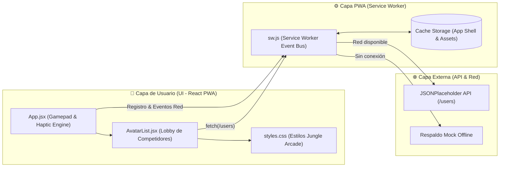

# PWA Mobile Controller - Gorilla Escape: Gorilimpiadas

Bienvenido al repositorio oficial del **Controlador Móvil PWA** para el videojuego **"Gorilla Escape: Gorilimpiadas"**. Esta Aplicación Web Progresiva actúa como un gamepad táctil e interactivo diseñado con enfoque *Mobile-First*, optimizado para pantallas táctiles y capaz de operar sin conexión en dispositivos móviles.

---

## 🏛️ Arquitectura del Sistema (React)

La interfaz fue construida con **React 18**, estructurada en componentes modulares y desacoplados:

1. **`App.jsx` (Componente Raíz / Controlador):**
   - Implementa un D-Pad virtual y botones de gran tamaño diseñados ergonómicamente para el pulgar.
   - Maneja el estado global del gamepad (`useState`) y la detección en tiempo real del estado de red (`navigator.onLine` mediante `useEffect`).
   - Proporciona retroalimentación háptica (vibración móvil) para mejorar la inmersión del jugador.

2. **`AvatarList.jsx` (Lobby de Personajes / Consumo de API):**
   - Consume de forma asíncrona la API pública de prueba ([JSONPlaceholder Users](https://jsonplaceholder.typicode.com/users)) para simular competidores y atletas en el lobby.
   - Renderiza tarjetas dinámicas con estados de carga (*skeleton/spinner*) y manejo resiliente de errores.

3. **`styles.css` (Diseño Modular & Temática de Jungla):**
   - Esquema de colores inspirado en la selva tropical (`#081c15`, `#1b4332`, `#2d6a4f`, `#52b788`, con acentos dorados `#f9c74f`).
   - Implementación de Flexbox y CSS Grid con sombras táctiles 3D y diseño adaptable.

---

## ⚡ Estrategia PWA y Modo Offline

La PWA garantiza una experiencia nativa mediante:
- **`manifest.json`:** Define la experiencia en modo `standalone` (sin barras de navegador), orientación vertical fija y tema jungle.
- **`sw.js` (Service Worker):**
  - **Pre-caching en Instalación:** Almacena en caché el *App Shell* básico (HTML, JavaScript, estilos y manifiesto).
  - **Estrategia Cache-First:** Sirve assets locales instantáneamente desde el caché.
  - **Soporte Offline para API:** Si el jugador pierde conectividad, el Service Worker intercepta la petición a la API y devuelve competidores de respaldo en caché o datos de rescate preconfigurados.

---

## 📊 Diagrama de Arquitectura



---

## 🚀 Instalación y Ejecución Local

1. Clona el repositorio e instala las dependencias:
   ```bash
   npm install
   ```
2. Inicia el servidor de desarrollo:
   ```bash
   npm run dev
   ```
3. Para probar la instalación como PWA en tu smartphone, conéctate en la misma red local o mediante un túnel HTTPS (como ngrok o Vite con SSL).

---

## 👤 Autor

- **Nombre:** Hiram
- **Correo Electrónico:** [hiramquintanasoto@gmail.com](mailto:hiramquintanasoto@gmail.com)
