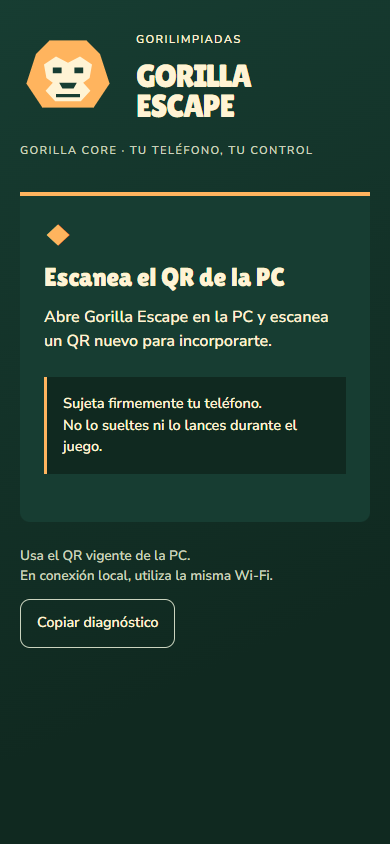
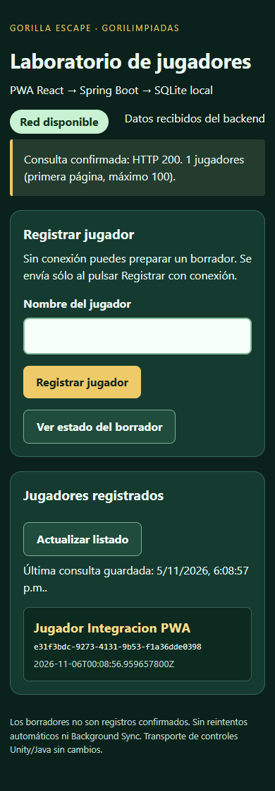

# Integración del frontend del juego

Fecha: 5 de noviembre de 2026. Origen del control: `Josue1855/Gorilla-Escape`, commit `1a62b2852cdb4647fe375bd3e39ff77cb3845da1`, directorio `PWA/`.

## Qué se trasladó

- Pantalla de admisión y diagnóstico, permisos por gesto, confirmación del nombre por la PC y recuperación de sesión.
- Controles de los diez juegos, pausa/reanudación, vuelta al menú, cambio de mano, ausencia y salida, según la autoridad enviada por la PC.
- Adquisición de sensores y transporte RTC, con suspensión en segundo plano y rechazo de muestras viejas. Cámara y disponibilidad del teléfono siguen bajo autoridad del juego.
- Tipografías locales con sus licencias, estilos, iconos y manifiesto del control.
- Pruebas del control y fixture del protocolo. La fixture se conserva localmente en `tests/fixtures/sensor.json`, sin depender de un checkout vecino.

El código del control conserva su comportamiento de origen. Este repositorio añade el montaje conjunto con el laboratorio, los proxies separados, la migración de caché y la demo histórica en una entrada propia. El servidor técnico y Unity permanecen en sus repositorios; no se copiaron Java, Flutter ni modelos 3D al frontend.

Se alinearon React 19.3.0 y plugin-react 6.1.2 con el control. Vite se fijó en 8.3.6 para resolver los avisos detectados por npm audit en 8.3.2. Node 24 y lockfile reproducible.

## Entradas y servicios

| Entrada o petición | Destino |
| --- | --- |
| `/` e `/index.html` | Control del juego. Sin QR válido, pide conectar con la PC. |
| `/lab.html` | Laboratorio de jugadores; mantiene IndexedDB y POST explícito. |
| `/demo.html` | Demo original de Hiram, con aviso de su alcance local. |
| `/api/players` | Spring Boot de jugadores, loopback :8090. |
| `/api/health`, `/mobile/*`, `/prepare` | Servidor técnico del juego, loopback :8080. |

`npm run serve` abre el control. `npm run lab` redirige `/` a `/lab.html`, para mantener esa URL separada del control en el worker. Ambos sirven `dist/` y utilizan los mismos proxies separados. `LAB_PORT`, `PLAYERS_PORT` y `CONTROL_PORT` permiten puertos de laboratorio distintos, siempre en loopback. `npm run dev` usa los destinos predeterminados a través de Vite. Preview no incluye proxies.

Un único worker cachea los recursos compilados del control, laboratorio y demo, excluyendo APIs y señalización. Elimina las cachés antiguas `gorilla-shell-*` y `gorilla-lab-shell-*` de este producto al activar una versión nueva; no elimina cachés de otras aplicaciones. No almacena sesiones, respuestas API ni POST, ni reenvía registros automáticamente.

Los dominios públicos del juego conservan la exclusión de registro de SW que trae el control, para no cachear su admisión. No se publicó un hosting ni se cambió el frontend original `Quintana-117/Dise-o_pwa`.

## Verificación realizada

| Comprobación | Resultado local |
| --- | --- |
| `npm test` | 107 aprobadas, 0 fallidas. Incluye proxies HTTP con servidores de fixture separados. |
| `npm run build` | Tres entradas compiladas y worker generado. |
| `npm audit` | 0 vulnerabilidades reportadas. |
| Vistas adaptables | 33 fixtures: menú y diez juegos a 320, 390 y 768 px, sin desbordamiento horizontal. |
| Control sin QR | Pantalla de conexión real, sin simular admisión. |
| Laboratorio con backend real | Registro HTTP 201, listado HTTP 200, un jugador confirmado, archivo SQLite real con cabecera verificada. |
| Offline | Recarga del control y del laboratorio; el jugador del laboratorio se conserva como consulta local. |
| Demo histórica | Renderiza su aviso y enlace al control; JSONPlaceholder se sustituye sólo por fixture durante esta comprobación. |
| Errores JavaScript de página | Ninguno durante la prueba de navegador. |

[Informe de navegador](evidence/controller-integration-2026-11-05/browser-integration.json), [pruebas Node](evidence/controller-integration-2026-11-05/node-tests.txt), [auditoría npm](evidence/controller-integration-2026-11-05/npm-audit.json).

Las capturas `lobby.png`, `bowling.png`, `log-balance.png` y `coconut-slice.png` son vistas de presentación con contextos de fixture, sin admisión ni sensores simulados como evidencia física. Las capturas de entrada y laboratorio provienen del build de producción con backend Spring Boot real.




## Repetir las pruebas de navegador

Con Node 24, Chrome/Chromium y `playwright-core` disponibles, indicar `GORILLA_TEST_PLAYWRIGHT` (ruta absoluta a `index.mjs`) y, si es necesario, `GORILLA_TEST_CHROME` (ruta al ejecutable). No se agrega Playwright al bundle de producción.

```powershell
npm ci
npm test
npm run build
node tools/verify-adaptive-controls.mjs

# Backend compilado con Maven; el script usa datos temporales y puerto automático.
$env:GORILLA_BACKEND_JAR = 'C:/ruta/Gorilla-Escape-Backend/target/backend-0.1.0-SNAPSHOT.jar'
node tools/verify-integration.mjs
```

El segundo script utiliza `JAVA_HOME` en Windows o `java` disponible en PATH. Arranca sus procesos de revisión, los cierra al terminar y elimina únicamente su directorio temporal validado. No utiliza el almacenamiento normal del jugador.

Pendiente: teléfono físico, permisos/sensores reales, conexión RTC al juego, ejecución Unity y HTTPS/LAN. No se declara aprobada la versión 1.0 a partir de estas pruebas de frontend.
